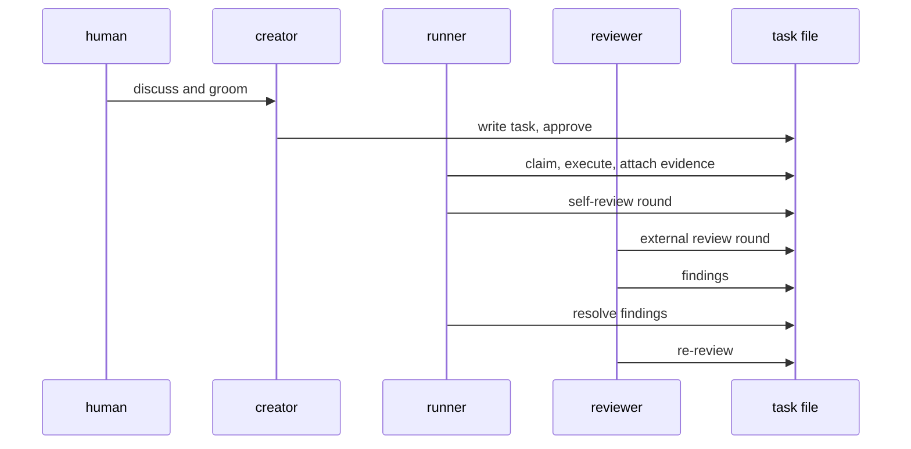

# Roles

The agents that act on tasks. Humans act too, but carry no role.

Task structure, statuses, and transitions live in
[tasks/task-model.md](tasks/task-model.md).

The three interfaces of coding-crew: **talita**, the CLI tool that writes and
manages tasks (**T**ask **A**dministration, **L**ifecycle & **I**nteraction
**T**erminal **A**pplication); **raul**, the TUI for the work that shows them
(**R**eview, **A**ssess, **U**nderstand & **L**earn); and **hugo**, the TUI for
the flow that governs the automation (**H**uman-guided **U**nified
**G**overnance & **O**rchestration).

## Actors

```json
{ "id": "runner-1", "kind": "agent", "role": "runner", "session": "s-42" }
```

| field | meaning |
|---|---|
| `id` | who acts |
| `kind` | `human` or `agent` — humans carry no role |
| `role` | `creator`, `runner`, `reviewer`, `orchestrator` |
| `session` | the working session, so separation between planning, execution, remediation, and review is structural rather than a matter of discipline |

## The roles



| role | owns | autonomy | never |
|---|---|---|---|
| `creator` | creates and edits tasks: intent, scope, acceptance criteria, steps, questions, meta; approves `groomed → approved` | human-dependent — its content comes from an interactive session with a human | executes or reviews code |
| `runner` | claims approved tasks, writes steps, executes, attaches evidence, applies fixes | autonomous | treats its own self-review as the verdict; approves a task |
| `reviewer` | reviews code, opens findings, gives verdicts | autonomous | writes code |
| `orchestrator` | autopilot flows | autonomous | — |

## Ownership by section

| task section | owner |
|---|---|
| `intent`, `scope`, `acceptance_criteria`, `questions`, `meta` | creator |
| `steps` | creator while grooming, runner while executing |
| `claim`, evidence | runner |
| `review` | reviewer |
| `notes` | any role |

`status` is written by transitions only; no role writes it directly.

The reviewer opens findings; the runner resolves them. A role may not write
another role's section.

`steps` is the one section with two owners, and the phase decides which: the
creator writes the steps while grooming, and once the task is approved the
runner owns them — it may add, split or drop them, and records a deviation
when it takes a different path.

## Session boundaries

- The session that executes a task never remediates that task's findings.
- The session that planned a task never reviews it.
- A review runs in a session distinct from the runner's, ideally on a
  different model — the diversity is what surfaces uncorrelated bugs.

These are gates, not guidance: a transition that would cross a boundary fails.

## Where roles act

| transition | role |
|---|---|
| — → `draft`, `draft` → `groomed`, `groomed` → `approved`, `needs-human` → `executing`, `done` → `executing` | creator |
| `approved` → `executing`, `executing` → `code-review`, `remediating` → `code-review` | runner |
| `code-review` → `done`, `code-review` → `remediating`, `code-review` → `needs-human` | reviewer |

Full gate conditions are in
[tasks/task-model.md](tasks/task-model.md#transitions).

## The order

The flow names the code-writing role **builder**. The task model calls the same
role `runner` in task files, and a configuration or runtime record that still
says `runner` is read as the builder.

The flow's order, step by step, as the configuration defaults to it: the steps
the sequence diagram shows, and the gate each one passes — a transition of
*Where roles act*.

| # | step | role | gate |
|---|---|---|---|
| 1 | `groom` | `creator` | `groomed → approved` |
| 2 | `build` | `builder` | `approved → executing` |
| 3 | `self-review` | `builder` | `executing → code-review` |
| 4 | `review` | `reviewer` | `code-review → done`, `code-review → remediating`, `code-review → needs-human` |
| 5 | `remediate` | `builder` | `remediating → code-review` |
| 6 | `re-review` | `reviewer` | `code-review → done` |

A review that escalates leaves the order at `needs-human`: a human decides, and
the task returns to `executing`, which is the creator's gate. The creator is the
human's grooming session, so the agents a configuration names are the builder,
the reviewer and the orchestrator.

`crates/core`'s default configuration is this table, and a test reads it from
here: an edit to one side alone fails the gate.
