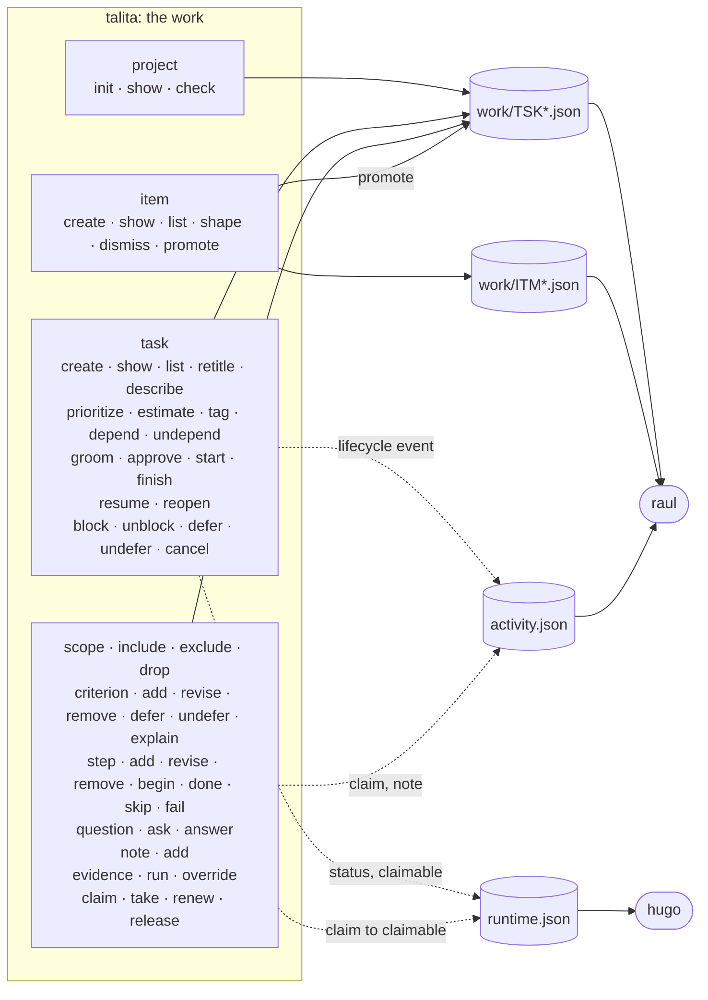
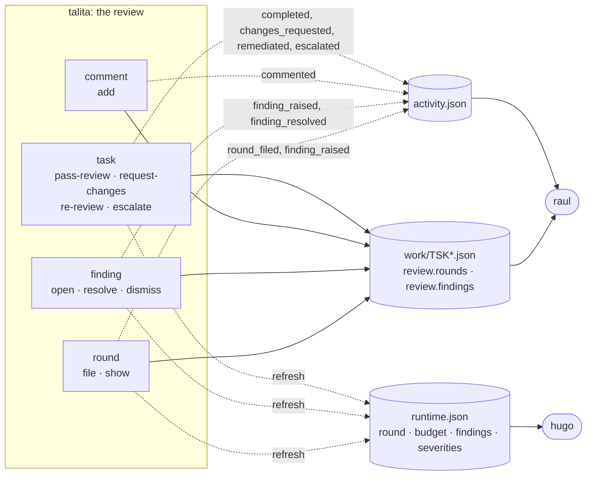
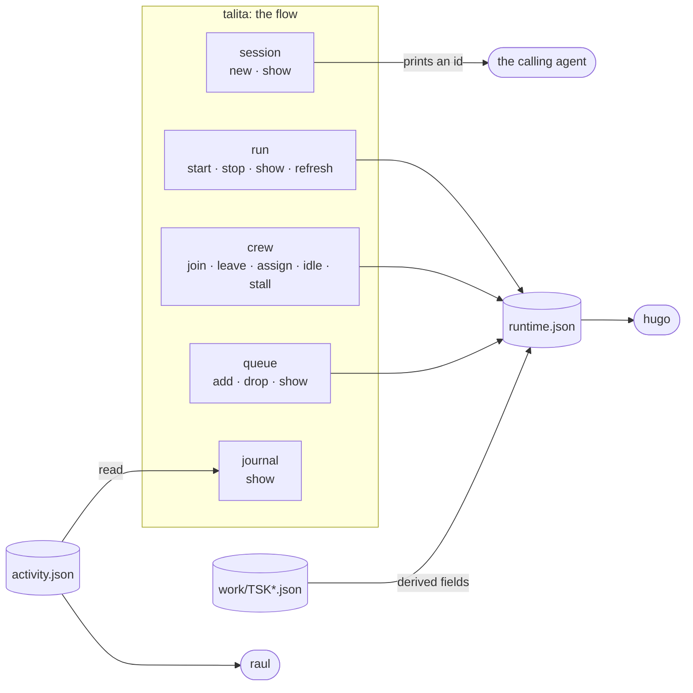
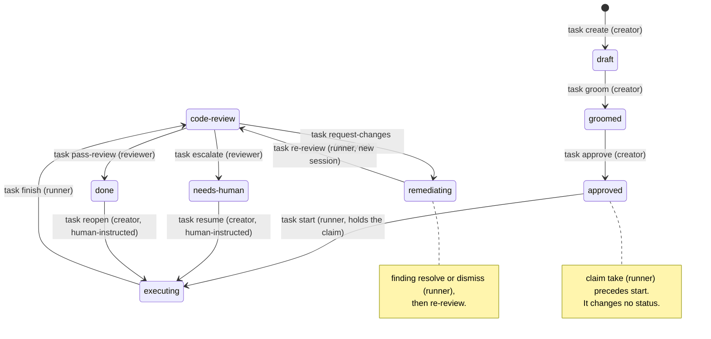
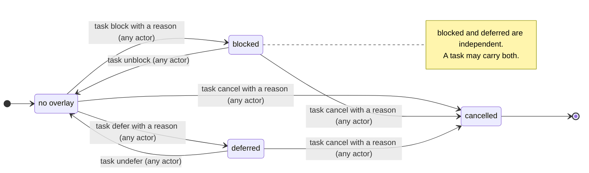
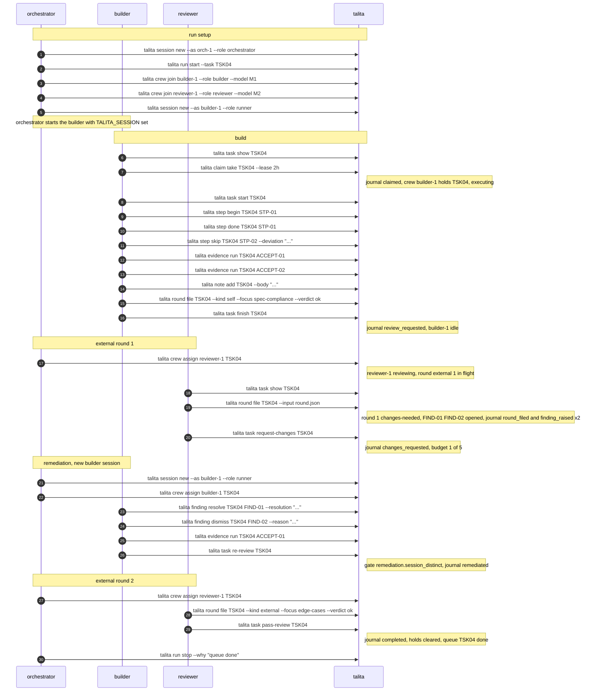

# talita

talita is coding-crew's CLI. Agents call it; humans read its results in raul
and hugo. It is the **only writer** of a project's `coding-crew/` folder: the
task files, the smaller tasks, the journal and the runtime record.

Status: **accepted design; nothing is built**. The full reference is
[commands.md](commands.md); the decisions are ADRs 0012–0020; the human's rulings
are in [decisions.md](decisions.md); the build order is [roadmap.md](roadmap.md).

## Principles

| Principle | Rule | ADR |
|---|---|---|
| One writer | Every file raul or hugo reads has exactly one writer: talita. No verb, no file: a field nothing writes is a gap, not a hand-edit | [0007](../decisions/0007-one-writer.md) |
| Noun, then verb | `talita <noun> <verb> <ids…> [flags]`. The noun is the part the call writes | [0012](../decisions/0012-noun-verb-grammar.md) |
| Intent verbs only | A verb names a domain act (`approve`, `resolve`, `claim`), never a field. There is no `set`, `edit` or raw-JSON escape hatch | [0013](../decisions/0013-intent-verbs.md) |
| Rules enforced, not trusted | Every write runs the lifecycle gates, section ownership, the frozen sections and the session boundaries. A refusal names the rule and the remedy | [0013](../decisions/0013-intent-verbs.md) |
| Agent-first output | JSON on stdout, one result shape, stable error codes, a fixed exit-code table | [0014](../decisions/0014-output-and-errors.md) |
| Identity is part of acting | Every write carries an actor, a role and a session. A write without them is refused | [0015](../decisions/0015-identity.md) |
| Side effects, not second calls | A verb that changes a task appends its journal event and refreshes the runtime record in the same call | [0018](../decisions/0018-runtime-and-journal-writers.md) |

## Nouns

| Noun | Is | Writes | Read by |
|---|---|---|---|
| `project` | the `coding-crew/` folder | the folder, `work/` | — |
| `task` | a task and its lifecycle | `work/TSK*.json` | raul |
| `scope` | a task's in- and out-of-scope lists | task | raul |
| `criterion` | an acceptance criterion | task | raul |
| `step` | a step | task | raul |
| `question` | an open decision on a task | task | raul |
| `note` | a learning on a task | task | raul |
| `evidence` | proof attached to a criterion | task | raul |
| `claim` | a runner's hold on a task, with a lease | task | raul, hugo (via `claimable`) |
| `round` | a review round, self or external | task | raul, hugo |
| `finding` | a defect a round raised | task | raul, hugo (counts) |
| `comment` | discussion under a finding | task | raul |
| `item` | a smaller task (`ITM*`) | `work/ITM*.json` | raul |
| `session` | an actor's working session | nothing (mints an id) | — |
| `run` | the flow's run | `runtime.json` | hugo |
| `crew` | the agents of the run | `runtime.json` | hugo |
| `queue` | the run's tasks, in order | `runtime.json` | hugo |
| `journal` | what happened, oldest first | read only — written as a side effect | raul |

Nouns are singular. Ids are positional, parent first: `talita finding resolve
TSK01 FIND-02`.

## Command map

Three areas, one graph each. Solid arrows: the file a verb writes. Dotted: a
side effect. The last column is who reads the file.

### The work

### The review

### The flow

## The task status machine

Each edge: the talita command, then the role allowed. The gates are task-model
§ 3.3's; the commands are in [commands.md](commands.md#task).

Overlays ride beside the status. Any actor may set or clear them, humans
included; a reason is required to set. `cancelled` is terminal and refuses
every later command on the task.

## A full unit

One task, `TSK04`, already `approved`. The orchestrator runs the flow; a fresh
builder session builds and another remediates; one reviewer session reviews
both rounds. Every talita call, in order. Each task-changing call appends its
journal event and refreshes `runtime.json` as part of the same call.

## Model changes this design asks for

The design stays inside the task model except where listed. Each is an
additive, optional field (raul ignores unknown fields) or a new journal kind.

| Change | Where | Why | ADR |
|---|---|---|---|
| `review.re_reviews[]` | task file | `task re-review` leaves a dated record of each hand-back; a `code-review` task after a round could not show it (TSK14) | [0017](../decisions/0017-review-record.md) |
| `Round.session` | task file | `review.independent` needs the filing session; `reviewer` stays the actor id | [0017](../decisions/0017-review-record.md) |
| `Evidence.manual` | task file | ADR 0006's "marked as a manual override" has no field | [0019](../decisions/0019-evidence.md) |
| `Task.revision` | task file | optimistic check for content verbs | [0016](../decisions/0016-concurrency.md) |
| `crew[].actor` | runtime record | match a crew row to the actor a verb acts as | [0018](../decisions/0018-runtime-and-journal-writers.md) |
| new journal kinds | journal | every lifecycle event and review act gets one | [0018](../decisions/0018-runtime-and-journal-writers.md) |
| gate `review.round_current` | core lifecycle | a reopened task could pass review on a stale `ok` | [0017](../decisions/0017-review-record.md) |
| gate `review.round_owner` | core lifecycle | the session that filed the verdict makes the move | [0017](../decisions/0017-review-record.md) |
| all failing gates reported | core lifecycle | one round trip per fix | [0014](../decisions/0014-output-and-errors.md) |
| `planned_by` set at `approve` | talita | nothing sets it today; `review.independent` refuses without it | [0015](../decisions/0015-identity.md) |
| gate `task.claimed` on `finish` | core lifecycle | only the claim holder hands the work to review | [0020](../decisions/0020-claims-and-leases.md) |
| claim as an operation | core | no `Event` exists for claiming | [0020](../decisions/0020-claims-and-leases.md) |
